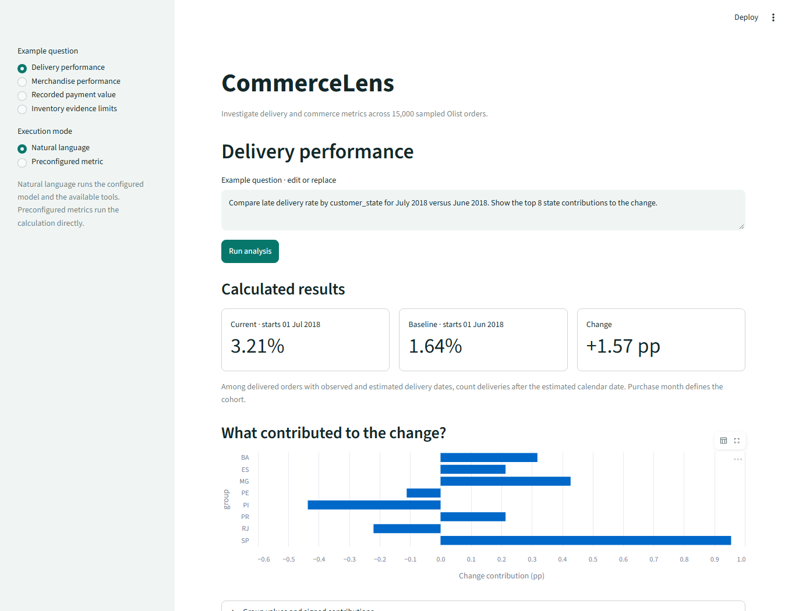
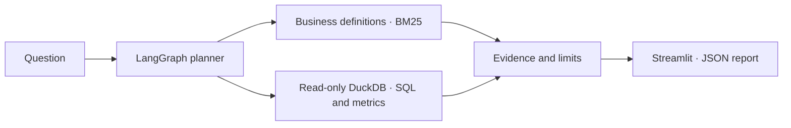

# CommerceLens

Ask an e-commerce question and see the calculation, SQL and business definition behind the answer.



*Live Streamlit run against a stratified sample of 15,000 Olist orders.*

## Project status

**Phase I — Foundation & Feasibility is engineering-complete.** Agent reliability is still in progress, and independent review of the Olist references is pending. See the [roadmap](docs/ROADMAP.md) for Phase I evidence and Phase II goals.

## What you can investigate

- **Delivery performance.** Compare late rates by purchase cohort and see which states contributed to the change, with the late count and eligible denominator.
- **Commerce performance.** Compare item-price totals by category and recorded payments by state. Each metric uses its own grain and shows signed group contributions.
- **Evidence limits.** Ask about warehouse inventory and see where the available data runs out. Export the analysis, SQL, business definitions and trace as JSON.



## What the experiments found

| Evaluation | Result |
| --- | --- |
| Olist business regression suite, 45 questions | SQL baseline **28/45**, SQL + retrieval **41/45**, full agent **40/45**. Independent human reference review is pending. |
| DataBench adapted subset, 80 previously exposed test questions | Baseline **29/80**, DDL + targeted retry **43/80**. |
| DataBench adapted subset, 48 questions on four other tables (now regression) | Baseline **3/48**, DDL + targeted retry **15/48**, additional semantic prompt **12/48**. The semantic prompt remains experimental. |

In the original evaluation of that 48-question subset, DDL + targeted retry answered 15 questions correctly and completed SQL on 33. Execution and answer accuracy are recorded separately. [Olist and MVP results](reports/acceptance.md) · [DataBench methods and failure analysis](reports/semantic-holdout.md)

## Run locally

Use Python 3.12 from the repository root:

```sh
python -m pip install -e ".[demo]"
python scripts/fetch_olist.py
python scripts/build_olist.py
python -m streamlit run app/streamlit_app.py
```

Select **Preconfigured metric** for a direct calculation on the rebuilt data. To run natural-language questions, start the [local model](docs/reproduction.md#local-model), select **Natural language**, and click **Run analysis**. See the [three-scenario walkthrough](docs/reproduction.md#three-minute-showcase).

The application uses LangGraph, DuckDB, SQLGlot, FastAPI and Streamlit. [Architecture and metrics](docs/architecture.md) · [Evaluation protocol](docs/evaluation.md) · [Independent review](benchmarks/REVIEW.md)

## Limits

The sample is historical. Recorded payments and merchandise value are separate proxies. The dataset supports descriptive comparisons and lacks warehouse inventory and causal attribution evidence. Public benchmark subsets support comparisons under the documented settings. Olist is available from its publisher under CC BY-NC-SA 4.0. [Olist source](https://www.kaggle.com/datasets/olistbr/brazilian-ecommerce)
