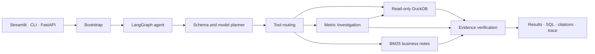

# Architecture and metric contracts

## Application flow

The framework-free domain owns metric definitions and calendar handling. The application owns contracts, the agent workflow and evidence rendering. Infrastructure implements DuckDB, the OpenAI-compatible client, BM25 and metric execution. Interfaces expose the graph and the structured metric tool through CLI, HTTP and Streamlit. Benchmark references and execution programs live outside the installed package.

The graph can request a corrected plan once after an execution or verification failure. Every SQL request passes through the same restricted adapter, including requests from the investigation tool. A generated query receives a relation and function allowlist, a read-only DuckDB connection with external access and extension loading disabled, locked settings, one worker, a 128 MB DuckDB memory budget, a four-second cooperative cancellation timer, and a 200-row/100 KB output budget. This is designed for a local portfolio deployment with curated data and limited concurrency. The timer and DuckDB memory limit are engine controls. Operating system process isolation and hard resource accounting would be needed before exposing it as a public multi-tenant service.

The agent obtains schema and lexical matches before planning. Knowledge excerpts are plain evidence. Only the runner can dispatch tools with structured arguments. The report preserves SQL output in `evidence.result`, derived metrics in `evidence.calculations`, business assumptions in `evidence.assumptions`, model abstention explanations in `model_explanation` and unresolved conclusions in `unconfirmed`. Streamlit displays the input populations and numerators for structured investigations and exports the full trace and response as JSON. Sample scope and execution caveats stay in `limits`.

## Data foundation

Olist's Kaggle v2 archive is SHA-256 pinned. Monthly integer quotas follow largest remainder, and rows within each cohort are ranked by SHA-256 of seed and order ID. Seven dependent tables are filtered to matching keys. Geolocation is excluded. The build retains review records for provenance, while the analytical views expose scores only. Monthly quotas, key checks, join fanout and monetary reconciliation appear in the generated manifest.

| Relation | Grain | Selected fields |
| --- | --- | --- |
| `orders` | One sampled order | Purchase date, state, status, payment value, eligible lateness, delivery days, per-order mean review score |
| `items` | One sampled order item | Purchase date, product category, customer state, seller, item price and freight |
| `seller_orders` | One order and seller | Purchase date, customer state, seller state and order-level lateness. Materialized during the build to keep grouped analysis within the query memory budget. |

## Metric registry

Definitions and valid dimensions are implemented in `src/commercelens/domain/metrics.py`. Dates refer to purchase cohorts with inclusive start and exclusive end. Full calendar months end on the first day of the following month. Portuguese category keys remain available when English translations are missing. An absent category maps to `unknown`.

| Metric | Calculation |
| --- | --- |
| Order count | Count orders of all statuses placed in the window. |
| Payment value proxy | Sum recorded payment values at order grain, including all statuses. |
| Merchandise value proxy | Sum item prices by product, category or seller grouping. Freight is excluded. |
| Late delivery rate | Late orders divided by delivered orders with both observed and estimated delivery dates. Compare calendar dates. |
| Seller-order late delivery rate | Same eligibility at seller-order grain. Multiple sellers can share one order's delivery outcome. |
| Mean delivery days | Mean elapsed days for delivered orders with a nonnegative observed delivery duration. |
| Mean review score | Average valid reviews within each order, then average across orders with reviews. Exclude unknown eligibility when comparing late and on-time orders. |

For additive metrics, group contribution is the difference between each group's current and baseline totals. For rate and mean metrics, each group's numerator is divided by its period's overall eligible population before differencing. Retained plus omitted contributions reconcile to the aggregate change. Descriptive differences in cohorts do not establish cause or identify who caused a delayed delivery.
